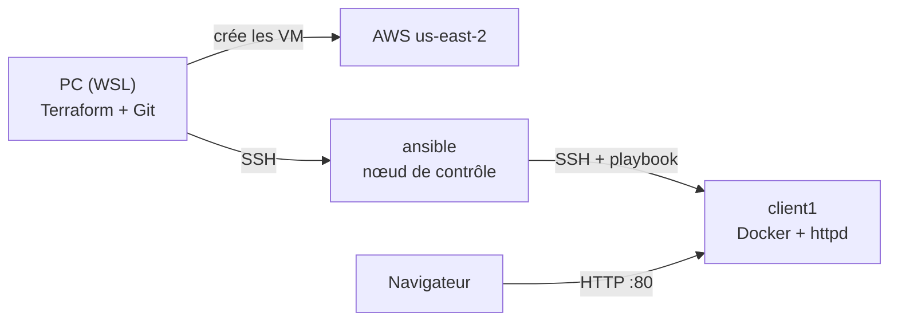

# TP-5 : Déployer un conteneur Apache avec un playbook Ansible

Déploiement automatisé d'un serveur **Apache (httpd)** dans un conteneur **Docker** sur un client AWS, à l'aide d'un **playbook Ansible**. L'infrastructure est créée avec **Terraform**.


## Sommaire

- [Description](#description)
- [Architecture](#architecture)
- [Structure du projet](#structure-du-projet)
- [Étapes du TP](#étapes-du-tp)
- [Résultats](#résultats)
- [Tests](#tests)
- [Différences avec l'énoncé](#différences-avec-lénoncé)
- [Difficultés rencontrées](#difficultés-rencontrées)
- [Contenu du dépôt](#contenu-du-dépôt)

## Description

Le TP consiste à écrire un **playbook** qui installe Docker sur un client, puis y lance un conteneur **httpd** exposé sur le **port 80**. Les informations de connexion sont séparées de l'inventaire grâce au dossier **`group_vars`**.

## Architecture



## Structure du projet

```
webapp/
├── prod.yml          inventaire YAML (groupe prod)
├── group_vars/
│   └── prod          variables de connexion du groupe prod
└── deploy.yml        playbook de déploiement
```

## Étapes du TP

| # | Question | Réalisation |
|---|---|---|
| 1 | Créer un cluster | **Terraform** (`infra/`) : `ansible` + `client1`, Debian 12, ports **22** et **80** ouverts |
| 2 | Dossier webapp | `tp5-playbook/webapp/`, copié sur le nœud de contrôle avec `scp -r` |
| 3 | Inventaire `prod.yml` | Groupe **`prod`** avec client1 comme seul membre |
| 4 | `group_vars/prod` | `ansible_user`, clé SSH, `StrictHostKeyChecking=no` |
| 5 | Playbook `deploy.yml` | Installe Docker, démarre le service, lance le conteneur **httpd** (`80:80`) |
| 6 | Prérequis | `docker.io` et `python3-docker` avec le module **`apt`** |
| 7 | ansible-lint | Installé avec apt, **0 failure, 0 warning** (profil production) |
| 8 | Vérification port 80 | `curl` et navigateur → **« It works! »** |
| 9 | Options de debug | `--list-tasks`, `--check`, `-v`, `-vvv`, `--start-at-task` |
| 10 | GitHub | Ce dépôt |

Commande d'exécution (depuis le nœud de contrôle) :

```bash
cd ~/webapp
ansible-playbook -i prod.yml deploy.yml
```

## Résultats

Première exécution :

```
client1 : ok=4 changed=2 unreachable=0 failed=0
```

Exécutions suivantes : **`changed=0`** (playbook **idempotent**).

## Tests

| Test | Commande | Résultat |
|---|---|---|
| Syntaxe | `ansible-playbook deploy.yml --syntax-check` | OK |
| Bonnes pratiques | `ansible-lint deploy.yml` | **0 failure, 0 warning** |
| Simulation | `ansible-playbook -i prod.yml deploy.yml --check` | `changed=0` |
| Site web | `curl http://<IP publique client1>` | **It works!** |

## Différences avec l'énoncé

| Énoncé | Réalisé | Raison |
|---|---|---|
| Module **`yum`** | Module **`apt`** | Les machines sont sous **Debian 12** (`ansible_pkg_mgr: apt`) ; yum est réservé à la famille Red Hat |
| Login + **mot de passe** dans `group_vars/prod` | Login + **clé SSH** | L'authentification SSH par mot de passe est **désactivée** sur les instances AWS |
| (non précisé) | Ajout de **`python3-docker`** | Requis par le module `community.docker.docker_container` |
| (non précisé) | Port **80** ouvert dans le security group | Nécessaire pour accéder au site depuis Internet |

## Difficultés rencontrées

| Problème | Cause | Solution |
|---|---|---|
| Les 3 instances ont été **supprimées** (`terminated`) | Nouvelle image Debian publiée : `most_recent = true` a changé l'AMI, ce qui force le **remplacement** ; `apply` validé avec `3 to destroy` | Ajout de **`lifecycle { ignore_changes = [ami] }`** ; toujours lire la ligne `Plan:` avant `yes` |
| Plan Terraform incohérent | Mauvais réseau Wi-Fi | Changer de réseau, refaire `plan` |
| VS Code ne se connecte plus à WSL (`0x8007274c`) | Service WSL bloqué | `wsl --shutdown` puis relancer |
| `ansible: command not found` | Commande lancée sur le **PC** au lieu du nœud de contrôle | Vérifier le prompt, ou utiliser `ssh admin@IP "commande"` |
| `Could not resolve hostname` | Variable **`IP`** vide dans un nouveau terminal | `IP=$(terraform -chdir=infra output -raw ansible_public_ip)` |
| `Broken pipe` avec `-vvv` | `head -40` ferme la sortie avant la fin | Sans conséquence |

## Contenu du dépôt

| Fichier | Rôle |
|---|---|
| `webapp/prod.yml` | Inventaire YAML |
| `webapp/group_vars/prod` | Variables de connexion |
| `webapp/deploy.yml` | Playbook |
| `../infra/main.tf` | Infrastructure Terraform partagée par les TP |
