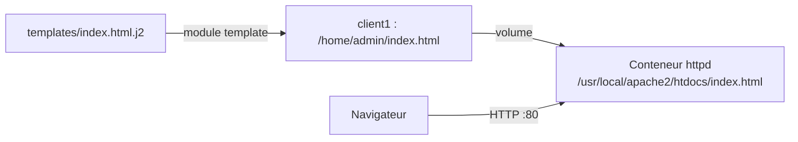

# TP-6 : Déployer son propre site avec Ansible

Déploiement d'un site personnalisé dans un conteneur **Apache (httpd)** à l'aide d'un **playbook Ansible** : **loop**, **condition**, **template Jinja2** et **montage de volume Docker**.


## Sommaire

- [Description](#description)
- [Architecture](#architecture)
- [Structure du projet](#structure-du-projet)
- [Étapes du TP](#étapes-du-tp)
- [Playbook final](#playbook-final)
- [Résultats](#résultats)
- [Différences avec l'énoncé](#différences-avec-lénoncé)
- [Difficultés rencontrées](#difficultés-rencontrées)
- [Sources](#sources)

## Description

Ce TP reprend le projet **webapp** du TP-5 et le fait évoluer : le site par défaut d'Apache est remplacé par une page générée à partir d'un **template Jinja2**, qui affiche **« Bienvenue sur -nom de l'hôte- »**. Le nom de l'hôte provient des **facts** collectés par Ansible.

## Architecture



## Structure du projet

```
webapp/
├── prod.yml               inventaire (groupe prod)
├── group_vars/
│   └── prod               variables de connexion
├── templates/
│   └── index.html.j2      template de la page
└── deploy.yml             playbook
```

## Étapes du TP

| # | Question | Réalisation |
|---|---|---|
| 1 | Cluster + code webapp | Instances redémarrées (`aws ec2 start-instances`, `terraform apply -refresh-only`), code du TP-5 récupéré avec `git pull` |
| 2 | Template | `templates/index.html.j2` avec **`{{ ansible_facts['hostname'] }}`** |
| 3.1 | Loop | Installation de **git** et **wget** avec `yum` et **`loop`** |
| 3.2 | Condition | **`when: ansible_facts['distribution'] == "CentOS"`** |
| 3.3 | Template | Module **`template`** → `/home/admin/index.html` |
| 3.4 | Volume | **`volumes`** → `/usr/local/apache2/htdocs/index.html` |
| 4 | Vérification | `curl` et navigateur → **« Bienvenue sur ip-172-31-39-170 »** |
| 5 | GitHub | Ce dépôt |

## Playbook final

```yaml
---
- name: Deployer Apache avec Docker
  hosts: prod
  become: true

  tasks:
    # Paquets git et wget (CentOS uniquement)
    - name: Installer git et wget
      ansible.builtin.yum:
        name: "{{ item }}"
        state: present
      loop:
        - git
        - wget
      when: ansible_facts['distribution'] == "CentOS"

    # Prérequis
    - name: Installer Docker et le module Python docker
      ansible.builtin.apt:
        name:
          - docker.io
          - python3-docker
        state: present
        update_cache: true

    - name: Demarrer Docker
      ansible.builtin.service:
        name: docker
        state: started
        enabled: true

    # Page du site
    - name: Generer la page index.html
      ansible.builtin.template:
        src: templates/index.html.j2
        dest: /home/admin/index.html
        mode: "0644"

    # Conteneur Apache
    - name: Lancer le conteneur Apache
      community.docker.docker_container:
        name: webapp
        image: httpd
        state: started
        ports:
          - "80:80"
        volumes:
          - /home/admin/index.html:/usr/local/apache2/htdocs/index.html
```

Exécution depuis le nœud de contrôle :

```bash
cd ~/webapp
ansible-playbook -i prod.yml deploy.yml
```

## Résultats

```
TASK [Installer git et wget]
skipping: [client1] => (item=git)
skipping: [client1] => (item=wget)

client1 : ok=5 changed=1 unreachable=0 failed=0 skipped=1
```

- La tâche **git/wget** est ignorée, car client1 est sous **Debian** (la condition est évaluée pour chaque élément de la loop).
- Le site affiche **« Bienvenue sur ip-172-31-39-170 »**.

## Différences avec l'énoncé

| Énoncé | Réalisé | Raison |
|---|---|---|
| Installer git et wget avec **yum** | Tâche écrite avec `yum`, mais **ignorée** (`skipping`) | Client sous **Debian 12** ; la condition **CentOS** empêche l'exécution de `yum`, qui n'existe pas sur Debian |
| Code webapp « stocké sur GitHub » | `git pull` sur le PC, puis `scp` vers le nœud de contrôle | Dépôt **privé** : évite de stocker un token GitHub sur l'instance |
| Login + mot de passe (TP-5) | **Clé SSH** | Authentification par mot de passe désactivée sur AWS |

## Difficultés rencontrées

| Problème | Cause | Solution |
|---|---|---|
| `UNREACHABLE`, connexion vers **18.188.139.47** | `prod.yml` contenait l'**IP publique** de client1, qui change à chaque redémarrage | Utiliser l'**IP privée** (172.31.39.170), qui ne change pas |
| `rm tp6` ne fonctionne pas | `rm` ne supprime pas les dossiers | `rm -r` |
| `syntax error near unexpected token '<'` | Les chevrons `< >` de la documentation ont été copiés | Les retirer : ce sont des repères à remplacer |
| `Invalid flags before the subcommand` | Faute de frappe `-chldir` | `-chdir` |

## Sources

- [Templating (Jinja2)](https://docs.ansible.com/projects/ansible-core/2.15/playbook_guide/playbooks_templating.html)
- [Loops](https://docs.ansible.com/projects/ansible-core/devel/playbook_guide/playbooks_loops.html)
- [Conditionals](https://docs.ansible.com/ansible/3/user_guide/playbooks_conditionals.html)
- [ansible.builtin.yum](https://docs.ansible.com/projects/ansible-core/2.15/collections/ansible/builtin/yum_module.html)
- [ansible.builtin.template](https://docs.ansible.com/ansible/4/collections/ansible/builtin/template_module.html)
- [community.docker.docker_container](https://docs.ansible.com/projects/ansible/latest/collections/community/docker/docker_container_module.html)
- [httpd — Docker Hub](https://hub.docker.com/_/httpd)
- [AWS CLI — ec2 start-instances](https://docs.aws.amazon.com/cli/latest/reference/ec2/start-instances.html)
- [Terraform — refresh-only](https://developer.hashicorp.com/terraform/cli/v1.12.x/commands/refresh)
