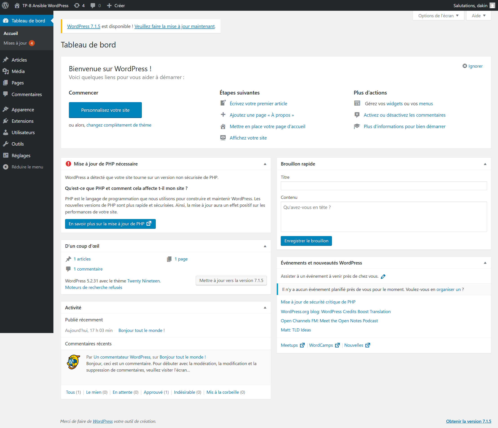
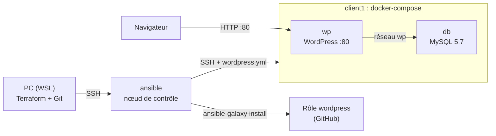
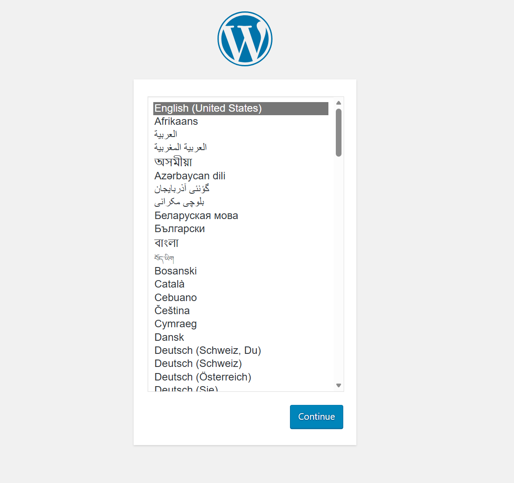
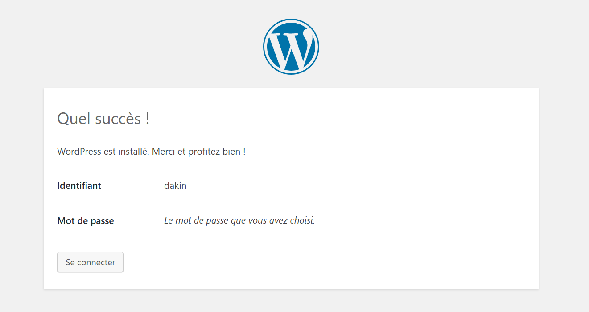

# TP-8 : Déployer WordPress avec un rôle Ansible

Déploiement de **WordPress** et de sa base **MySQL** dans des conteneurs **Docker** sur un client AWS, à l'aide d'un **rôle Ansible** externe installé avec **ansible-galaxy**. Les mots de passe de la base proviennent d'un fichier chiffré avec **Ansible Vault** (TP-7).




## Sommaire

- [Description](#description)
- [Architecture](#architecture)
- [Structure du projet](#structure-du-projet)
- [Analyse du rôle](#analyse-du-rôle)
- [Étapes du TP](#étapes-du-tp)
- [Playbook](#playbook)
- [Résultats](#résultats)
- [Tests](#tests)
- [Différences avec l'énoncé](#différences-avec-lénoncé)
- [Difficultés rencontrées](#difficultés-rencontrées)
- [Limites](#limites)
- [Contenu du dépôt](#contenu-du-dépôt)
- [Sources](#sources)

## Description

Un **rôle** est un ensemble de tâches, de variables et de templates **réutilisable et partageable**. Ce TP utilise le rôle [diranetafen/ansible-role-containerized-wordpress](https://github.com/diranetafen/ansible-role-containerized-wordpress) : on ne réécrit pas le déploiement, on **installe le rôle** et on **surcharge ses variables** pour l'adapter à notre environnement.

Le rôle génère un fichier **`docker-compose.yml`** et lance deux conteneurs :
- **`wp`** : WordPress (Apache + PHP), exposé sur le **port 80** ;
- **`db`** : MySQL 5.7, accessible uniquement par WordPress, sur un réseau Docker interne.

## Architecture



## Structure du projet

```
webapp/
├── prod.yml                         inventaire (groupe prod)
├── group_vars/
│   └── prod                         variables de connexion
├── files/secrets/
│   └── credentials.vault            secret chiffré (Ansible Vault)
├── roles/
│   └── requirements.yml             référence du rôle à installer
├── wordpress.yml                    playbook du TP-8
├── deploy.yml                       playbook des TP précédents
└── templates/index.html.j2          template des TP précédents
```

Le code du rôle n'est **pas versionné** : seul **`requirements.yml`** l'est. Le rôle se réinstalle avec `ansible-galaxy`.

## Analyse du rôle

La lecture du code du rôle (`defaults/main.yml`, `tasks/main.yml`, `templates/docker-compose.j2`) a permis d'identifier les adaptations nécessaires :

| Constat dans le rôle | Conséquence | Adaptation |
|---|---|---|
| Déploiement avec **docker-compose** | Le binaire doit être présent | Installation de `docker-compose` avec `apt` (**pre_tasks**) |
| Binaire attendu dans **`/usr/local/bin`** | Sur Debian, apt l'installe dans `/usr/bin` | **`compose_binary_dir: /usr/bin`** |
| Utilisateur par défaut : **`ubuntu`** | Sur Debian, l'utilisateur est `admin` | **`system_user: admin`** |
| Port **80 écrit en dur** (`'80:80'`) | Conflit avec le conteneur Apache des TP précédents | Suppression du conteneur **`webapp`** (**pre_tasks**) |
| Attente de **`domain`** sur le port 80 | Par défaut, le domaine de l'auteur du rôle | **`domain: localhost`** |
| Le healthcheck MySQL utilise **`wp_db_psw`** comme mot de passe root | `wp_db_psw` et `db_root_psw` doivent être **identiques** | Les deux valent **`admin_password`** (fichier Vault) |

## Étapes du TP

| # | Question | Réalisation |
|---|---|---|
| 1 | Cluster + code du TP-7 | Cluster existant réutilisé, `git pull`, copie dans `tp8-wordpress/` |
| 2 | Playbook avec le rôle | `requirements.yml` + `ansible-galaxy install`, puis `wordpress.yml` avec surcharge des variables |
| 3 | Lancer et vérifier | Playbook exécuté, conteneurs `wp` et `db` actifs, installation de WordPress terminée dans le navigateur |

Installation du rôle (depuis le nœud de contrôle) :

```bash
cd ~/webapp
ansible-galaxy install -r roles/requirements.yml -p roles
```

Exécution :

```bash
ansible-playbook -i prod.yml wordpress.yml --ask-vault-pass
```

## Playbook

`roles/requirements.yml` :

```yaml
---
- src: https://github.com/diranetafen/ansible-role-containerized-wordpress.git
  name: wordpress
```

`wordpress.yml` :

```yaml
---
- name: Deployer WordPress avec Docker
  hosts: prod
  become: true
  vars_files:
    - files/secrets/credentials.vault
  vars:
    system_user: admin
    compose_binary_dir: /usr/bin
    domain: localhost
    wp_db_psw: "{{ admin_password }}"
    db_root_psw: "{{ admin_password }}"

  pre_tasks:
    # Prérequis du rôle
    - name: Installer docker-compose
      ansible.builtin.apt:
        name: docker-compose
        state: present
        update_cache: true

    # Libérer le port 80
    - name: Supprimer le conteneur Apache
      community.docker.docker_container:
        name: webapp
        state: absent

  roles:
    - wordpress
```

## Résultats

Exécution du playbook :

```
TASK [wordpress : Run docker-compose up]
changed: [client1]

TASK [wordpress : debug]
ok: [client1] => {"msg": "Site is reachable"}

client1 : ok=12 changed=7 unreachable=0 failed=0 skipped=1
```

Conteneurs actifs sur client1 :

```
IMAGE                    STATUS                PORTS                 NAMES
wordpress:5.2.4-apache   Up                    0.0.0.0:80->80/tcp    wp
mysql:5.7                Up (healthy)          3306/tcp, 33060/tcp   db
```

Installation de WordPress dans le navigateur :

| Choix de la langue | Installation réussie |
|---|---|
|  |  |

## Tests

| Test | Commande | Résultat |
|---|---|---|
| Installation du rôle | `ansible-galaxy install -r roles/requirements.yml -p roles` | `wordpress was installed successfully` |
| Syntaxe | `ansible-playbook wordpress.yml --syntax-check --ask-vault-pass` | OK |
| Déploiement | `ansible-playbook -i prod.yml wordpress.yml --ask-vault-pass` | `failed=0`, **Site is reachable** |
| Conteneurs | `ansible -i prod.yml prod -b -m command -a 'docker ps'` | `wp` et `db` (**healthy**) |
| HTTP | `curl -I http://<IP publique client1>` | **302** vers `/wp-admin/install.php` (`X-Redirect-By: WordPress`) |
| Navigateur | `http://<IP publique client1>` | Installation terminée, tableau de bord accessible |

## Différences avec l'énoncé

| Énoncé | Réalisé | Raison |
|---|---|---|
| Port externe au choix (80, 8080…) | **Port 80** | Le port est **écrit en dur** dans le template du rôle ; le changer imposerait de modifier ou de forker le rôle |
| (non précisé) | Suppression du conteneur Apache `webapp` | Il occupait déjà le port 80 |
| (non précisé) | Variables du rôle surchargées | Le rôle est prévu pour **Ubuntu** (utilisateur `ubuntu`, docker-compose dans `/usr/local/bin`) |
| (non précisé) | Mots de passe de la base issus du **Vault** | Réutilisation du TP-7 : aucun secret en clair dans le playbook |

## Difficultés rencontrées

| Problème | Cause | Solution |
|---|---|---|
| Impossible de choisir le port 8080 par variable | Port `'80:80'` codé en dur dans `docker-compose.j2` | Utilisation du port 80 et suppression du conteneur Apache |
| Variables du rôle inadaptées à Debian | Rôle écrit pour Ubuntu | Surcharge de `system_user` et `compose_binary_dir` dans `vars` |
| Mots de passe affichés à l'exécution | Le rôle affiche les variables de base de données dans une tâche `debug` | Ne pas publier cette sortie ; utiliser un secret de démonstration |
| Page d'installation WordPress publique | Le premier visiteur peut créer le compte administrateur | Terminer l'installation immédiatement après le déploiement |

## Limites

- Le rôle utilise des versions **anciennes** : WordPress **5.2.4** (PHP 7.3) et **MySQL 5.7**. Le tableau de bord signale d'ailleurs une mise à jour de PHP nécessaire.
- Le rôle n'est **pas idempotent** sur la tâche `docker-compose up` (module `command`) : elle est toujours marquée `changed`.
- Le site est servi en **HTTP**, sans certificat.

## Contenu du dépôt

| Fichier | Rôle |
|---|---|
| `webapp/wordpress.yml` | Playbook de déploiement de WordPress |
| `webapp/roles/requirements.yml` | Référence du rôle (installé avec ansible-galaxy) |
| `webapp/files/secrets/credentials.vault` | Mot de passe chiffré avec Ansible Vault |
| `webapp/prod.yml`, `webapp/group_vars/prod` | Inventaire et variables de connexion |
| `images/` | Captures du déploiement |

## Sources

- [Rôle diranetafen/ansible-role-containerized-wordpress](https://github.com/diranetafen/ansible-role-containerized-wordpress)
- [Galaxy User Guide — installation de rôles](https://docs.ansible.com/ansible/9/galaxy/user_guide.html)
- [Galaxy — format de requirements.yml](https://old-galaxy.ansible.com/docs/using/installing.html)
- [Ansible Vault](https://docs.ansible.com/archive/ansible/2.4/vault.html)
- [community.docker.docker_container](https://docs.ansible.com/projects/ansible/latest/collections/community/docker/docker_container_module.html)
